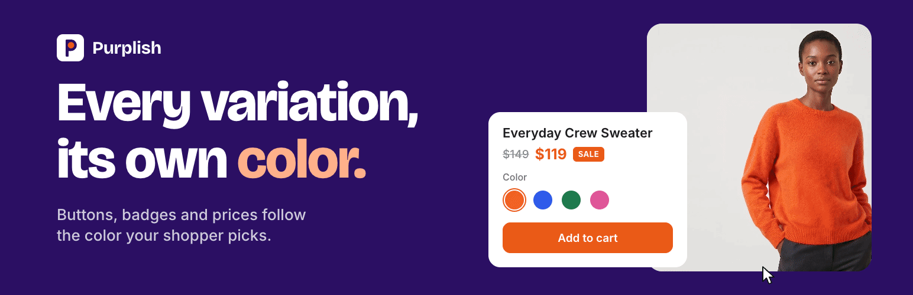
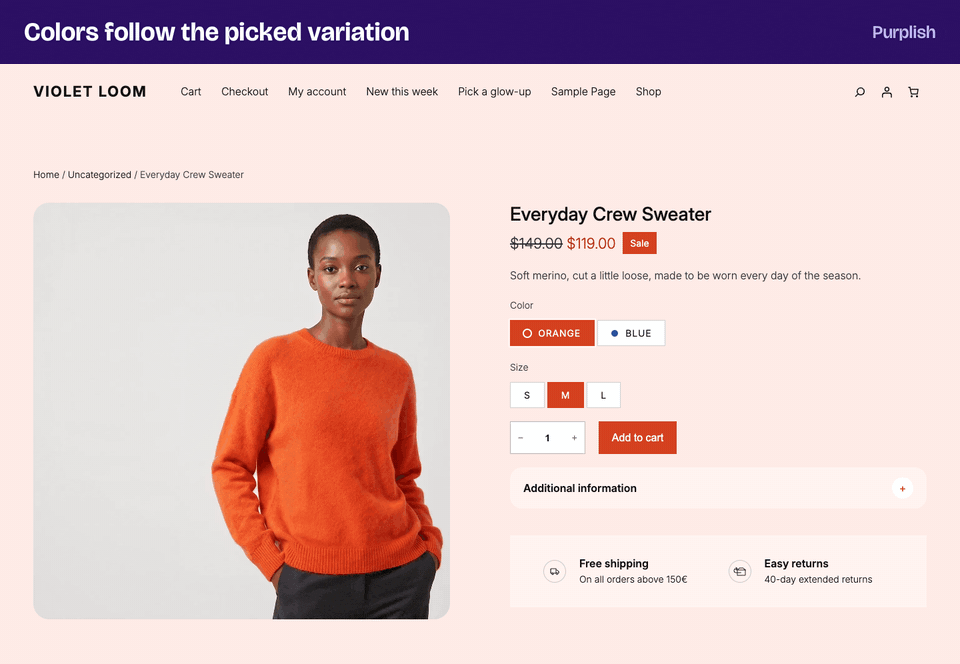

# Purplish

Design your whole store with blocks.



WooCommerce's blocks are good, but every store that uses them starts out looking alike: the same add to cart button, the same gallery, the same product cards. Purplish is a block design toolkit that gives those blocks, and the patterns you build from them, the design options they don't have on their own.

Select a block in the Site Editor, open the Purplish panel, and decide how it looks and moves. You need no page builder and no custom CSS, and WooCommerce's own markup stays in place. It's made with the free [Purple](https://wordpress.org/themes/purple/) theme in mind.

[Install from WordPress.org](https://wordpress.org/plugins/purplish/) · [Website](https://purplish.io/) · [Changelog](CHANGELOG.md) · [Contributing](CONTRIBUTING.md)

[](https://github.com/shameemreza/purplish/actions/workflows/ci.yml)
[](https://wordpress.org/plugins/purplish/)
[](https://www.gnu.org/licenses/gpl-2.0.html)

## What you can design

| Area | Block | What you can design |
|---|---|---|
| Product page | Add to Cart + Options | A color for each variation that the page follows, photo transitions, title and price rise, glow ring, halo, mesh background, color dots, and liquid glass, a spectrum ring and googly eyes on the button. |
| Product page | Variation Selector, On-Sale Badge | Crossed out or blurred options that can't be bought, and a pill, circle or price tag badge in any corner of the photo. |
| Product page | Product Reviews, Product Specifications | Reviews on soft cards or in chat bubbles, and a striped or card-style specifications table. |
| Product gallery | Product Gallery | 7 hover styles, 5 full-screen styles, 4 slide styles, hidden, rounded or circle thumbnails, rounded corners and frosted arrows. |
| Shop and collection pages | Product Collection | 23 card effects, details or add to cart on the photo, and button motion. |
| Shop and collection pages | Shelf Tag, Stock Indicator | Purplish's own Shelf Tag block: a Best seller, New arrival or Featured tag on the photo that shows only on the cards its rule matches. A sold-out pill from the Stock Indicator, with the sold-out photo greyed. |
| Shop and collection pages | Hanging Rail | Purplish's own block: products hang from pegs, binder clips or tape on a rope, and slide along it as the page scrolls. |
| Shop and collection pages | Runway | Purplish's own block: product photos stand in a line that fades into the distance, and visitors walk it with the product cards beside it. |
| Shop and collection pages | Scroll Lookbook | Purplish's own block: a full-screen video or photo that plays as visitors scroll, stopping at each product with its card beside it. |
| Shop and collection pages | Showfloor | Purplish's own block: a shop-the-look hero where cut-out looks stand on a turning floor, and visitors open a look to add its pieces to the cart. |
| Shop and collection pages | Changing Room | Purplish's own block: tops and bottoms turn in two rings around a model, and visitors dress him before they add the outfit to the cart. |
| Header | Navigation, Group | Purplish's own Wardrobe block: a menu item that opens a big panel under the header, with category links, photo tiles and a featured look, all made of blocks you edit in place. A header that stays at the top and narrows into a floating pill as the page scrolls, and the Flagship header and phone menu patterns that put it all together. |
| Home page | Cover, Group, Columns, Product Collection, Showfloor | The Flagship home pattern: a full store front page from the floor down to the newsletter, with each section also its own pattern, and Push in, Tilt, Lift and Glare on hover for the Cover block. |
| Footer | Heading, Social Icons | A big wordmark that rises from the floor as the page scrolls, social icons in thin rings, and the Flagship footer pattern that puts it together. |
| Filters and cart | Product Filters, Mini-Cart, Mini-Cart Contents | Active filters that match the filter chips, a filter sidebar that can fold away, a count that pops and a product photo that flies into the cart icon when something goes into the cart, and a cart drawer with a spring slide, soft rows and bigger photos. |
| Cart, checkout and order confirmation | Cart, Proceed to Checkout, Mini-Cart Proceed to Checkout Button, Checkout, checkout Actions, Order Status, Order Summary | Soft rows, bigger photos and sticky totals on the Cart page, soft, filled or underline fields, a focus ring, card or list choices, step numbers, a soft summary card, a side panel, a raised card and bigger photos on the Checkout, a glow ring, light sweep, liquid glass and spectrum ring on Proceed to Checkout, Go to checkout and Place Order, a lock on Place Order, a thank-you moment on the order heading and a receipt card for the order summary. |
| Any page | Image, Button | The 7 gallery hover styles on any image, and a glow ring, light sweep, liquid glass, spectrum ring and googly eyes on any button. |
| Any page | Story Deck | Purplish's own block: customer stories on a deck of cards that visitors flick through, with the story beside the top card. |
| Scroll motion | Heading, Group, Columns, Cover, Featured Category, Featured Product | Headings that rise or come into focus, sections and columns that fade up or zoom in, and covers with a slow zoom, parallax or pill reveal as the page scrolls. |
| Page sections | Accordion, Accordion Group, Details, Group | A soft style for both accordions and the Details block, and sections that take the page color. |

## How it works

- **Settings live on the block:** what you pick in the Purplish panel is saved on the block in the template, so each template keeps its own look.
- **WooCommerce's markup stays in place:** Purplish styles the blocks WooCommerce renders and replaces nothing. Deactivate it, and the store renders exactly as WooCommerce draws it.
- **Scripts load only where they're used:** the color script loads on variable products only, and each effect loads only on pages that use it. A simple product page with no effects loads no script.
- **Photos stay on your server:** colors are read from variation photos in the background, with the image tools PHP already has, and saved with the product.
- **Nothing extra:** no outside requests, no tracking, and no banners, notices or upsells in the admin.
- **Motion with manners:** nothing moves on its own. Every effect plays on a hover, a scroll, a color change, an add to cart, an opened cart drawer or a placed order, then stops, and reduced motion turns it all off.

## Product page

On a default WooCommerce product page, picking another color changes the photo and nothing else. With Purplish, the add to cart button, the selected option, the sale badge and the sale price follow the color the shopper picks, and a soft tint can follow it behind the page.



Each variation has a Page color: **Automatic** reads it from the photo (a swatch color comes first), **Custom** takes any color or hex code, and **Off** keeps your theme's colors. Automatic colors keep the photo's hue and get adjusted for each use, so the button text stays readable. Simple products get one color for the whole page.

On the same block:

- **Photo transition:** Blur, Fade, Zoom, Slide, Flip, Wipe, Circle reveal, Color wash or None.
- **Title and price rise:** after the photo changes, the title and price rise into place, or the title comes into focus.
- **Glow ring and halo:** a soft ring in the page color around the add to cart button, and a ring that leaves it each time a product goes into the cart.
- **Mesh background:** soft blobs of the color over the background tint, which move each time the color changes.
- **Color dots:** each color option shows a dot in its own color. Sizes, and options that come in several colors, get no dot.
- **Liquid glass and spectrum ring:** the add to cart button gets a frosted fill with a highlight that follows the mouse, and a rainbow ring that travels once around its edge on hover.
- **Googly eyes:** one or two eyes inside the add to cart button follow the mouse and blink when it moves again after a pause.

On other blocks:

- **Variation Selector, Grayed-out look:** options that can't be bought get a diagonal line over the chip (swatches too), or they blur out. To hide them, use WooCommerce's own Invalid options setting.
- **On-Sale Badge, Shape and Corner:** a pill, circle or price tag badge. On the gallery photo, it can sit in any corner.
- **Product Reviews, Review style:** each review on its own soft card, or the review text in a chat bubble.
- **Product Specifications, Table style:** every other row shaded, or each row on its own soft card. Screen readers still read it as a table.

## Product gallery

| Option | Choices |
|---|---|
| Hover style | 3D tilt leans the photo toward the mouse, Zoom magnifies the spot under it, Loupe shows a round magnifier. Lift, Parallax, Glare and Slow zoom add softer motion. |
| Full-screen style | Snap stack is tinted to the page color, Zoom from photo grows out of the photo, Filmstrip adds small photos along the bottom, Cinema uses a dark screen, Classic fade keeps it plain. |
| Slide style | 3D media gallery turns like a cube, Circular slider swings like a wheel, Reel slider runs like film, Image tunnel comes out of the distance. |
| Layout | Hide the thumbnail strip, round the photo's corners, and add frosted arrows that show on hover. |
| Thumbnail shape | On the Thumbnails block inside the gallery: rounded or circle. |

Any hover style replaces WooCommerce's own hover zoom, and touch screens skip it. The full-screen style needs the gallery's "Open pop-up when clicked" setting.

## Product cards

On the Product Collection block, add to cart can sit on the photo as a small frosted button. Or the title, price and add to cart can all sit on the photo over a soft shade. One effect color drives the button fill, the card effects and the hover looks. Then pick one card effect for the whole collection:

| When it plays | Effect | What shoppers see |
|---|---|---|
| On hover | Spotlight | The card under the mouse grows while the rest blur and fade back. |
| | Color reveal | The photos sit in a color wash until the mouse brings one to full color. |
| | Fan deck | The cards rest slightly tilted. The one under the mouse straightens and its neighbors lean away. |
| | Expanded cards | Each photo shows as a narrow band and opens to full size under the mouse. |
| | Magnetic panel | A soft panel in the effect color slides under the card. |
| | Card folder | Each card sits in a soft folder with a tab, and the photo lifts out. |
| | Bookmark | Each card is a soft card with a notch cut from its lower edge, and the photo turns from gray to full color under the mouse. |
| | Roster | Product names as a big list beside one large photo. The name under the mouse, or in focus, shows its photo. |
| In a carousel | Deck | The cards at the edges turn away, and the one under the mouse faces you. |
| | Arc | The cards sit on a curve, highest in the middle. |
| | Spotlight carousel | The middle card is full size and the rest fade back. |
| | Grow | Cards grow as they reach the middle. |
| | Tilt | Cards lean as they travel across. |
| | Depth | The cards turn further away the closer they get to the edges, and the middle card faces you. |
| | Overlap | The cards lie over each other like prints on a table, each leaning its own way. The one under the mouse straightens and comes to the top. |
| | Momentum | The middle card is full size and the rest get smaller the further out they are. Drag and throw the strip with the mouse. |
| | Wheel | The cards ride the inside of a large wheel. The middle card sits lowest in full color, and the rest climb, lean in and turn gray. |
| | Helix | The cards wind onto two strands that twist against each other. Cards further out shrink back, blur and pick up colored edges like the rim of a lens. |
| | Reel | A coverflow: the middle card faces you and the rest stack in behind it, turned toward it and softer the further out. |
| On scroll | Clothes line | Each card hangs from a peg and swings as it comes in, or when the mouse touches it. |
| | Parallax | The photo moves slower than its card. |
| | Zoom reveal | Each card grows in as it appears. |
| | Unfold | Each row starts fanned together like a hand of cards and opens into a diagonal cascade as it scrolls up. Needs the Grid layout. |

Carousel effects play only when the collection is a carousel. A grid stays as it is. Momentum, Helix and Reel can also be dragged with the mouse. Roster and Unfold work the other way: they need a grid, and Roster shows the plain grid on phones and touch screens.

Under the card effect, pick where a hover look plays: the card, the photo, the add to cart button, or all three. Hover is off until you pick one, and it plays alongside any card effect.

| Part | Looks |
|---|---|
| Card | Lift, Tilt, Ring, Torch |
| Photo | Push in, Drift, Glare, Color bloom, Second photo (fades to the product's first gallery photo) |
| Button | Bag and sweep, Glow ring, Sweep, Spectrum ring, Liquid glass |

When the card effect already moves a part on hover, that part's look is skipped: Spotlight, Fan deck, Expanded cards, Magnetic panel, Card folder, Deck, Depth, Overlap and Clothes line skip the card look, Color reveal and Bookmark skip the photo look, and Roster has no hover looks. Without an effect color, the looks use your theme's text color. Collections saved with button motion keep it, as the Bag and sweep look.

### Shelf tags and sold out

Two more pieces go inside the card's Product Image block and sit on the photo:

- **Shelf Tag block:** a small tag that shows only on the cards its rule matches. The rules are best sellers (the store's top 1 to 50 by sales, 8 by default), new products (published in the last 1 to 365 days, 30 by default) and featured products. Pick a chip, a pill or frosted glass, the corner, your own words in place of Best seller, New arrival or Featured, and a light that passes over the tag once on hover. In the editor, the tag shows faded on the cards it leaves out. Best sellers are worked out again after each order, and at least every six hours.
- **Sold out:** on the Stock Indicator block, Only when sold out hides the indicator on every other stock state and shows Out of stock in a pill, a chip or glass, in the corner you pick. Grey out sold-out cards turns the photo grey and soft, and brings some of it back on hover.

## Filters and mini-cart

- **Product Filters, Matching chips:** the active filters take the look of a selected chip, with its colors, corners and letter case, and a chip fades into its selected color when picked.
- **Product Filters, Sidebar can hide:** a Hide filters button beside Sort by folds the filter sidebar away with a width change, and the products take the space. It needs the filters in a column beside the products. The choice lasts for the visit, phones keep WooCommerce's filter overlay, and with the overlay on every screen there's no sidebar, so nothing changes.
- **Mini-Cart, Count pop and Fly to cart:** the item count pops with a ring in its own color, and the bag gives a small turn, each time something goes into the cart. Fly to cart sends the product photo from the card or product page into the cart icon.

## Cart, checkout and order confirmation

- **Proceed to Checkout, Place Order and Go to checkout, Looks:** the glow ring, light sweep, liquid glass and spectrum ring from the Button block, in any mix. One effect color drives the glow and the glass. Place Order can also show a small lock before its label. Place Order is in the checkout's Actions block, and Go to checkout is in the Mini-Cart drawer.
- **Mini-Cart drawer, Looks:** the drawer opens with a soft spring and the items follow one after another. Items can sit on soft rounded rows, with bigger photos.
- **Cart, Looks:** items on soft rounded rows, bigger product photos, and totals that stay in view while a long cart scrolls.
- **Checkout, Looks:** soft, filled or underline fields, a focus ring in the effect color, shipping and payment choices as cards or one list with the picked one tinted, step numbers as badges or a timeline, the order summary on a soft rounded card with a bigger total, a tinted side panel, the whole checkout on a raised card, and bigger order photos. Labels still float, and nothing on the checkout moves.
- **Order Status, Thank-you moment:** when the order confirmation page opens, the heading rises into place and a burst of rays in the effect color flashes behind it once. The heading is never hidden while it rises.
- **Order Summary, Receipt card:** the order number, date, total and payment method sit on a paper receipt with a torn bottom edge and a dashed line between rows.

Touch screens get the button looks without the hover parts, and visitors who turn on reduced motion see the heading and buttons without the motion.

## Page sections

- **Accordion, Soft style:** each item becomes a soft card, and the plus turns into an x that fills with the page color when the item is open.
- **Accordion Group, Soft style:** the same soft cards on WooCommerce's own accordion, with its icon in a round button that fills with the page color when open.
- **Details, Soft style:** the block becomes a soft card, and a round plus turns into an x that fills with the page color when open.
- **Group, Take the page color:** on product pages, the section's background becomes a soft version of the color the shopper picks.

## Images and buttons

- **Image, Hover style:** the gallery's 7 hover styles on any image block, from 3D tilt to Slow zoom. The photo grows inside its own frame, so the caption and the lightbox button stay where they are.
- **Button, Looks:** a glow ring, a band of light that sweeps across on hover, liquid glass and a spectrum ring, in any mix. Googly eyes, one or two, sit inside the button and follow the mouse. One effect color drives the glow and the glass.
- **Social Icons, Ring:** each icon sits in a thin round ring in the icon color, and the ring fills on hover. Set the icon color to match the section.

Touch screens and visitors who turn on reduced motion see the plain image and button.

## Scroll entrances

- **Heading, Reveal on scroll:** the heading rises into place or comes into focus as it scrolls into view. Rise from the floor follows the scroll instead: the bottom edge of the heading is the floor, and the heading comes up out of it, made for a big footer wordmark.
- **Group and Columns, Entrance on scroll:** the section fades up or zooms in as it scrolls into view, and columns come in one after another.
- **Cover, Scroll effect:** the background slowly zooms or drifts with the scroll, or the cover opens from a small rounded pill to its full size as it comes into view. Hover adds four looks: Push in moves the background in slowly, Tilt turns the whole cover toward the mouse with a sheen, Lift raises it with a soft shadow, and Glare runs a light after the mouse. Featured Category and Featured Product get the same scroll and hover looks, on their background photo.
- **Group, Condense on scroll:** made for headers. The section stays at the top of the window and narrows into a floating pill with frosted glass as the page scrolls, then opens out again at the top.
- **Group, Turn on hover:** made for badges and seals. The section turns a little, like a stamp, when the mouse is over it or over the group around it. Phones and visitors who ask for reduced motion see it still.

- **Pattern:** Flagship footer is a full store footer for the footer template part. A size help line with an Ask about a size button and a size guide link, four link columns (Shop, Help, Company and social icons in rings), the site name as a big serif wordmark that rises from the floor, and a base row with the year, privacy and terms links, a secure checkout note and a Back to the floor button.
- **Patterns:** Flagship home is a full store front page for new pages. It opens on a Showfloor of eight looks on the drawn figures, then your four biggest product categories as tall tiles that tilt toward the mouse on hover, 4 best sellers with a ring on hover and add to cart on the photo, a brand band that opens from a pill, the 4 newest products with the Spotlight card effect, the customer stories deck on deep purple, a trust row (shipping, returns, secure checkout, real people) and a newsletter sign-up with three figures on a lavender floor. Each section opens on a serif heading, most with a short line under it, and sits on its own background so the page alternates light, lavender and deep purple. Each section also ships as its own pattern: Flagship floor, Shop by category, Best sellers, Brand band, Just in, Trust row and Newsletter. Shop by category builds its tiles with a Terms Query, so each one is a Featured Category with the category's own image, its name and a Shop now button to its page. A category without an image shows a deep purple tile. Pick other categories in the Terms Query settings. Before WooCommerce 11.3 the pattern shows four tiles on the drawn figures instead, since Featured Category can't read the category from a Terms Query there.
- **Patterns for the cart and checkout:** Empty cart is made for the Cart block's empty cart area. A free shipping note, a big serif Your bag is empty that rises in, Shop new in and See best sellers buttons, four category tiles on the drawn figures that tilt toward the mouse, and 4 best sellers with the Spotlight card effect. It holds no add to cart buttons, since WooCommerce's interactive blocks stop working inside that area, so the cards link to the product. Checkout header is for the Checkout Header template part: the site title, Bag, Checkout and Done steps with Bag linked back to the cart, and a Secure checkout note. Nothing on it moves. Money-back guarantee card goes under the Cart or Checkout block: a stamp-style 30 days seal that turns on hover, the promise, and three proof chips. It fades up once.

Each entrance plays once. Condense on scroll and Rise from the floor follow the scroll both ways. Visitors who turn on reduced motion see the blocks as they are, with the header as a full bar, and nothing stays hidden if the script doesn't load.

## Hanging Rail block

A block of Purplish's own, in the Purplish group of the block inserter. It holds a heading, a short line and one Product Collection, so you pick the products the way you already do: new arrivals, a category or hand-picked.

- **Products on a rope:** the section holds still while the page scrolls, and the products slide along a rope that sags between them. Scroll back and they slide back. Each card swings on its clip when the scrolling speeds up or stops, then settles.
- **Clip:** a wooden peg, a binder clip or a strip of tape.
- **Rope sag:** a little or more.
- **Scroll length:** short, medium or long. It follows how many products there are, so the rail feels the same with 4 products or 16.
- **Pattern:** Hanging rail of new arrivals adds the block with a heading, a short line and your 8 newest products.

Visitors who turn on reduced motion see the products as a row they can scroll sideways, with the rope and clips still drawn. Keyboard users can tab through every product, and the page scrolls each one into view.

## Story Deck block

A block of Purplish's own, in the Purplish group of the block inserter. Each story is a group with a photo, a quote, the customer's name and, if you want, a button to the product. The photos become a deck of cards, and the top card's story sits beside it.

- **Flick through:** visitors drag or swipe the top card away, or use the previous and next buttons or the arrow keys. The card flies off, the next one comes up and the story beside it changes. After the last story the deck starts again.
- **Deck side:** left or right. On phones the cards sit above the story.
- **Card shape:** rounded or square.
- **Fan:** fanned, where the cards under the top one lean out like a hand of cards, or flat.
- **Pattern:** Customer stories deck adds the block with three sample stories, each with a Shop this button. Add your own photos, or leave them out and each card shows a quote mark.

The deck never moves on its own. Visitors who turn on reduced motion switch stories with a short fade, and screen readers hear each new story after a button or key press. Without the script the stories show as a plain list of cards.

## Runway block

A block of Purplish's own, in the Purplish group of the block inserter. It holds a heading, a short line and one Product Collection, so you pick the products the way you already do. Every product photo becomes a look, and the looks stand in one line that gets smaller and softer toward the back.

- **Walk the line:** visitors drag or swipe, swipe sideways on a trackpad, tap a look further back, or use the previous and next buttons or the arrow keys. The front look steps out, the next one comes forward and a new one comes out of the haze at the back. After the last look the first one returns.
- **Product rail:** the product cards sit beside the line and follow the look at the front, with the photo, name, price and add to cart. On phones they run under the line as one row.
- **Looks from:** each product's featured photo and its gallery photos, or the featured photo only.
- **Photo shape:** framed, or cutout for product photos with a transparent background.
- **Look number:** the big look number next to the buttons, on or off.
- **Fly to cart:** the product photo flies into the mini cart when a visitor adds it to the cart. It needs the Mini-Cart block on the page, usually in the header.
- **Pattern:** Runway lookbook adds the block with a heading, a short line and your 6 newest products.

The line never moves on its own, and a normal mouse wheel still scrolls the page past it. Visitors who turn on reduced motion step one look at a time with a short fade and no blur, and screen readers hear each new look after a button or key press. Without the script the products show as the collection you set up.

## Scroll Lookbook block

A block of Purplish's own, in the Purplish group of the block inserter. It holds Cover blocks, one Product Collection and a Group, so it edits like the blocks you already use. Each Cover is a shot and the first one opens the film. As visitors scroll, the camera moves from shot to shot and holds at each one, and that product's card comes in on the side away from the subject. Scrolling back runs the film back. At the end it returns to the opening shot, where the Group shows as the closing line.

- **Shots:** each Cover holds a video or a photo. The camera reads the Cover's focal point, so the card never covers the subject. Photos zoom slowly as the page scrolls.
- **Cards:** the first Product Collection gives the cards. Card 1 comes in at the second shot, card 2 at the third, and so on. Each card's button takes its product's Purplish color.
- **Chapter list:** names each stop beside the film, from a paragraph with the class `is-chapter` in each Cover, or the product name. On or off.
- **Timecode:** a running timecode in the corner while the film plays. Off by default.
- **Scroll length:** short, medium or long, for how much scrolling each stop takes.
- **Pattern:** Scroll lookbook storefront adds the block with an opening shot, three shots, an empty hand-picked collection to fill and a closing line, then a heading and four products after it.

Videos follow the scroll smoothly when they have a keyframe every few frames. Most phone and stock clips have one every second or two, so scrolling back stutters. This ffmpeg line makes a clip that scrubs well, without sound:

```bash
ffmpeg -i in.mp4 -an -vf scale=1920:-2 -r 25 -g 5 -keyint_min 5 -bf 0 -crf 24 -movflags +faststart out.mp4
```

The opening video plays once when the page loads and stops within 5 seconds. Nothing else plays on its own, and nothing loops. Visitors who turn on reduced motion, and themes that clip the page so the film can't stay on screen (Storefront is one), get each shot with its card beside it as a plain page. Tab reaches every card, and the page scrolls to the card that has focus. Developers can listen for the `purplish:stop` event and change the smoothing and the opening play with the `purplish_scroll_lookbook_config` filter.

## Showfloor block

A block of Purplish's own, in the Purplish group of the block inserter. It holds Look blocks, one for each look. Each Look has a full-length cut-out photo with a transparent background, a name, a short line and the products in it. The looks stand on an oval floor, and the one at the front shows its name, its pieces and their total beside the floor.

- **Turn the floor:** visitors drag or swipe, tap a look further back or its name in the look list, or use the previous and next buttons or the arrow keys.
- **Open a look:** Shop this look, or a tap on the front look, opens it as a price tag with a numbered marker on each piece. Tapping a marker highlights its piece, or adds it to the cart.
- **Add the whole look:** one button adds every piece of the look at the price shown. Variable products link to their product page instead, and their look gets no whole-look button.
- **Floor and grid:** a switch moves between the floor and a grid of every look. The block can start on either.
- **Floor options:** an oval floor or a flat row, a subtle, strong or flat depth, and on phones a swipe row with the next looks peeking in, or a smaller floor.
- **Look list:** numbers and names, faces, names only, numbers only, or off. The face crop comes from a focal point you set on each Look.
- **Drawn figures:** eight figures drawn for Purplish ship in `assets/figures/`, for patterns and the inserter preview. A Look uses its image URL when it has no media library image, so a pattern can point at them. A look with no products shows its figure and name only, until you pick the products in it.
- **Autoplay:** off by default. When it's on, the floor turns every 3 to 8 seconds, with a pause button that shows a timer ring, a plain pause button, or no button.
- **Shopping options:** the Shop this look button and its text, add buttons with text or an icon, the look total, and photos that fly into the mini cart.

Autoplay holds while a visitor hovers, focuses or drags the floor, opens a look or views the grid, and it never runs for visitors who turn on reduced motion. Hiding the pause button leaves autoplay without a way to stop it, so the block panel says so when you pick that. Without the script the front look shows with its products.

## Changing Room block

A block of Purplish's own, in the Purplish group of the block inserter. It holds Piece blocks, one for each product. A Piece goes in the top ring or the bottom ring and has a flat cut-out of the product with a transparent background. Without a cut-out, it shows the product image. In the middle stands a photo of the model wearing the top and bottom at the front. You add one photo for each pair in the block panel.

- **Dress the model:** visitors drag a piece onto him, swipe or scroll a ring, use the arrow keys, or tap a piece. The ring springs round, and his photo changes to the new pair. The pair he wears stays in the page address, so a shared link opens on the same outfit.
- **Piece panel:** a tap opens a panel from the side with the cut-out, the price, stock, a size picker for variable products, Details and About tabs, Try it on and Add to cart.
- **Add both:** one button under the model adds the top and bottom at the price shown. When a piece needs a size, the panel opens and asks for it first.
- **After adding:** a notice with the photo and a View cart link, and the photo flies into the mini cart. Each can be turned off.
- **Look and color:** add buttons in your theme's button style or a Purplish look: glow ring, light sweep, liquid glass or spectrum ring. Their color comes from the last piece worn, the top, the bottom, or none, and can tint the buttons and notice, the whole block, or the whole page.
- **Other options:** a heading, the hint line, the names and prices under the model, pieces further round the ring, the panel and each of its parts, each way to turn a ring, ring labels, and a fade, reveal or instant photo change.

Visitors who turn on reduced motion get every change at once, without the spring, fades or the fly to the cart.

## Wardrobe block

A block of Purplish's own that goes inside the Navigation block, where you add it like any menu item. It shows a label in the menu, and hovering or clicking the label opens a big panel under the header. The panel holds blocks, so you edit it in place. A new Wardrobe starts with category links, three photo tiles and a featured look, all pointing at your shop page.

- **Opens like your submenus:** the Navigation block's Submenus open on setting decides it. On hover, the panel opens when the pointer rests on the label and stays open while it moves into the panel. On click, only a click opens it. Always open opens on click, since a panel that never closes would cover the page.
- **Keyboard:** Tab reaches the label, Enter or Space opens the panel, and Tab moves into it. Escape closes it and puts focus back on the label. Focus leaving the item or a click outside closes it too, and only one panel is open at a time.
- **Panel options:** Wide, Content or Full width, from your theme's sizes, and a Card look with rounded corners and a soft shadow, or a Flat sheet straight under the header.
- **A look for each link:** put more than one look card in the panel and each one goes with a category link, in order. Hovering or focusing a link shows its look, and the first look shows when the panel opens. In the editor, the look card you select shows in place.
- **Phones:** on small screens and inside the Navigation overlay, the label is a plain link to the page in the Link setting, or to the shop page when that's empty.
- **Patterns:** Flagship header is a full store header for the header template part. A note bar scrolls away, then a bar with a Wardrobe Shop menu that has a look for each category, more links, the site title in a serif in the middle, and search, account and a bag pill whose count pops. The bar has Condense on scroll on. Flagship phone menu is the sheet its menu opens on phones: the site title and a close button, large links that rise in one after another, and a look card. Create it from the Navigation block's Overlay template setting.

The panel sits centered under the header, stays inside the window and scrolls when the window is short. Visitors who turn on reduced motion see it open without the unroll. Without the script the label is a plain link.

## Abilities for AI agents

Purplish registers four abilities with the WordPress Abilities API, in a category named Purplish. The REST API lists them at `/wp-json/wp-abilities/v1/abilities`, and the [MCP Adapter](https://github.com/WordPress/mcp-adapter) plugin hands them to AI agents as tools. An agent can ask what Purplish can do, read the options a page uses, set them on a block and add a pattern.

| Ability | What it does |
|---|---|
| `purplish/get-design-catalog` | Lists Purplish's own blocks, the options it adds to each WooCommerce and core block with the values each option takes, the page options and the patterns. Set `type` to `blocks`, `options` or `patterns` for one part. |
| `purplish/get-page-designs` | Lists every block on a page, post, template or template part that takes Purplish options, with its path, its saved options and the classes they print. |
| `purplish/set-block-design` | Sets one block's Purplish options, found by `path` or `anchor`, such as `{"hover": "tilt"}`. `null` clears an option. A value the catalog doesn't list is refused. |
| `purplish/insert-pattern` | Adds a Purplish pattern at the `start` or `end`, or `after` the block at a path. |

- **Pages and templates:** give `post_id` for a page or post. For a template or template part the Site Editor hasn't saved yet, give `template`, such as `purple//single-product`, and set `template_type` to `wp_template_part` for a part.
- **Permissions:** the catalog needs the `edit_posts` capability. The other three need permission to edit that page, or `edit_theme_options` for a template.
- **What changes:** only the block's Purplish options, and each change saves a revision. Product data, sale badge text and the rest of WooCommerce's settings belong to WooCommerce's own abilities.

## Block and classic themes

Purplish is built for block themes. Classic themes get a smaller set under WooCommerce > Settings > Products > Purplish.

| Feature | Block themes | Classic themes |
|---|---|---|
| Page colors and photo transitions | Yes | Yes, except the selected option |
| Title and price rise | Yes | Yes |
| Gallery: hide thumbnails, rounded corners, hover style | Yes | Yes |
| Gallery: full-screen and slide styles, frosted arrows | Yes | No |
| Product cards, card effects and card hover looks | Yes | No |
| Title focus, glow ring, halo, mesh background, color dots | Yes | No |
| Accordion and Group styles | Yes | No |
| Grayed-out look, badge shape and corner, thumbnail shape | Yes | No |
| Details, review and specifications styles | Yes | No |
| Matching filter chips, mini-cart count pop | Yes | No |
| Image hover styles, button looks, social icon rings, and glass, spectrum ring and googly eyes on add to cart | Yes | No |
| Heading reveals, group and columns entrances, cover scroll effects | Yes | No |
| Checkout button looks, thank-you moment, receipt card | Yes | No |

## Get started

1. Install and activate Purplish. It reads the colors of your variation photos in the background.
2. To change a variation's color, edit the product, open Variations and use the Page color field. For a simple product, it's on the General tab.
3. On a block theme, open a template in the Site Editor and select a block. Purplish adds a panel to WooCommerce's Product Gallery, Thumbnails, Add to Cart + Options, Variation Selector, Product Collection, On-Sale Badge, Product Reviews, Product Specifications, Product Stock Indicator, Featured Category, Featured Product, Product Filters, Mini-Cart, Mini-Cart Contents, Mini-Cart Proceed to Checkout Button, Accordion Group, Cart, Proceed to Checkout, Checkout, checkout Actions, Order Status and Order Summary blocks, and to the Accordion, Details, Group, Columns, Heading, Cover, Image, Button and Social Icons blocks. Its own blocks, Hanging Rail, Story Deck, Runway, Scroll Lookbook, Showfloor and Changing Room, are in the Purplish group of the block inserter, Shelf Tag joins them inside a product card, and Wardrobe is in the Navigation block's inserter. On a classic theme, go to WooCommerce > Settings > Products > Purplish.

## Requirements

| | Minimum | Tested up to |
|---|---|---|
| WordPress | 7.0 | 7.1 |
| PHP | 7.4 | 8.3 |
| WooCommerce | 11.0 | 11.2 |

## For developers

Purplish has a small set of PHP hooks, front-end events and CSS custom properties for theme and add-on code. All of them arrived in 1.1.0.

### PHP hooks

| Hook | Type | What it changes |
|---|---|---|
| `purplish_blocks` | Filter | The Purplish block classes to register. Remove one to turn that block off, with its scripts and styles. |
| `purplish_patterns` | Filter | The Purplish patterns to register, keyed by slug. |
| `purplish_color_set` | Filter | The color set of a variation or simple product, with the product object. Return `null` for no color. A set with only `color` gets the other parts worked out from it. |
| `purplish_detected_color` | Filter | The hex color the photo detector picked, with the attachment ID, before it's saved. Return an empty string to save no color. |
| `purplish_block_classes` | Filter | The classes Purplish adds to a block's wrapper, with the block name and its saved Purplish options. |
| `purplish_shelf_tag_show` | Filter | Whether a Shelf Tag shows on a product card, with the product and the tag's block attributes. |
| `purplish_scroll_lookbook_config` | Filter | Scroll Lookbook numbers that aren't in the block panel, with the block attributes: `smoothing` (how fast the film catches up with the scroll, 1 to 30, default 9) and `hold` (the longest the opening video plays, 0 to 30 seconds, default 5). |
| `purplish_loaded` | Action | Fires once Purplish has added its own hooks. |

To keep every product page in one brand color:

```
add_filter( 'purplish_color_set', function () {
	return array( 'color' => '#6b3fa0' );
} );
```

To turn off the Runway block:

```
add_filter( 'purplish_blocks', function ( $blocks ) {
	return array_diff( $blocks, array( \Purplish\Blocks\Runway::class ) );
} );
```

### Front-end events

Both events fire on `document`, so theme scripts and analytics can listen without touching Purplish's files.

| Event | Fires when | `event.detail` |
|---|---|---|
| `purplish:colorchange` | The product page color changes, when a shopper picks a variation or clears the selection. | The new color set (`color`, `on`, `ink`, `tint`), or `null` when the page goes back to the theme colors. |
| `purplish:stop` | Scroll Lookbook lands on a stop. | `stop`, the stop number (1 is the first product card), and `block`, the block's element. |

```
document.addEventListener( 'purplish:colorchange', ( event ) => {
	console.log( event.detail ? event.detail.color : 'theme colors' );
} );
```

### CSS custom properties

When a product page has a color, Purplish sets four properties on `body`, next to the `purplish-active` class:

| Property | What it holds |
|---|---|
| `--purplish-accent` | The button color. |
| `--purplish-on` | Black or white, whichever reads better on the accent. |
| `--purplish-ink` | A deeper shade for text on the page, like the sale price. |
| `--purplish-tint` | The pale background tint. |

Purplish's own blocks read their sizes and colors from properties on the block wrapper, so one line in a theme stylesheet or the Additional CSS box changes them:

```
.wp-block-purplish-story-deck {
	--purplish-deck-radius: 0.5rem;
}
```

| Block | Properties |
|---|---|
| Hanging Rail | `--purplish-rail-card` (card width), `--purplish-rail-gap` |
| Story Deck | `--purplish-deck-card` (card width), `--purplish-deck-gap`, `--purplish-deck-radius`, `--purplish-deck-paper` (the base color the card fill mixes with) |
| Runway | `--purplish-runway-mist` (stage and rail background), `--purplish-runway-paper` (the floor fade and every other card), `--purplish-runway-edge` (space at the edges) |
| Scroll Lookbook | `--purplish-lookbook-card-radius`, `--purplish-lookbook-card-paper`, `--purplish-lookbook-card-ink` (card text color), `--purplish-lookbook-gap`, `--purplish-lookbook-edge` |
| Wardrobe | `--purplish-wardrobe-radius`, `--purplish-wardrobe-gap` (space between the header and the panel), `--purplish-wardrobe-pad` (space inside the panel), `--purplish-wardrobe-width` (panel width), `--purplish-wardrobe-tint` (tile and look card background) |

## Why I made it

> Purplish started with one small idea from [a chat on X](https://x.com/shameemdev/status/2116510521612755209) with [Luigi Teschio](https://x.com/gigitux): let the product page take the color of the variation a shopper picks. Building it showed me how much more WooCommerce's blocks can do with a few good options, so I kept going. The [Purplish website](https://purplish.io/) runs on WooCommerce, the Purple theme and Purplish itself.
>
> Shameem Reza

## Contributing

Bug reports and fixes are welcome. [CONTRIBUTING.md](CONTRIBUTING.md) covers the local setup and the checks every change has to pass. Please report security issues privately through the [security policy](SECURITY.md).

## License

Free and open source, under GPLv2 or later.
